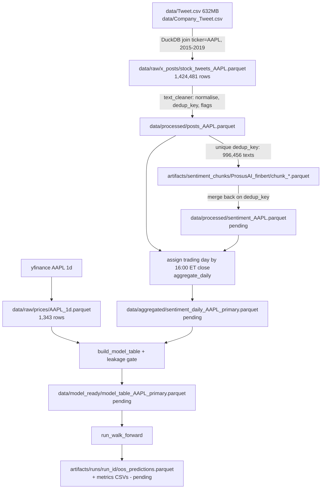

# Data Flow and Lineage Diagram

"pending" = not yet produced (as of 2026-11-05). Per-dataset detail: [DATA_LINEAGE](../data/DATA_LINEAGE.md). Independent pipelines: prices (above) and news (Tavily → `data/raw/news`, not implemented).
