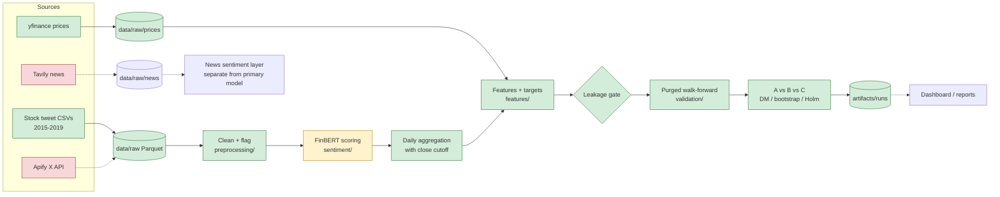

# System Architecture

Status of each box is in [IMPLEMENTATION_TRACKER](../engineering/IMPLEMENTATION_TRACKER.md). Dashed = not implemented.

Green = implemented and tested/run; yellow = running; red = blocked (credentials). "Done" for CMP means the code is tested on synthetic data — it has not produced a real result.

See [DATA_FLOW](../architecture/DATA_FLOW.md), [MODULE_ARCHITECTURE](../architecture/MODULE_ARCHITECTURE.md), [CODEBASE_MAP](../engineering/CODEBASE_MAP.md).

## Update 2026-11-05
All boxes in the diagram above are now implemented except the live sources (red: credentials missing). Additional implemented stages: ablation, multi-horizon/deep, nowcast, regimes, importance, monitoring, reporting/dashboard. The 'CMP' box has produced real results (see [RESEARCH_FINDINGS](../research/RESEARCH_FINDINGS.md)). Dashboard/reports are generated by `scripts/generate_report.py`.
